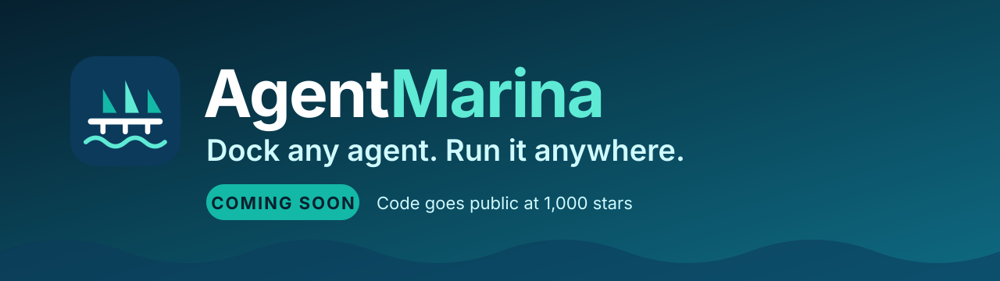

# AgentMarina: Dock any agent. Run it anywhere.

### The self-hosted runtime for deploying AI agents. Framework-neutral, production-minded.

An open-source alternative to AWS AgentCore, Google Vertex AI Agent Engine and Azure AI Foundry Agent Service.  
Keep your framework. Keep your cloud. Keep your data.

[Problem](#the-problem) · [Cost](#what-it-costs-to-run-agents) · [What it does](#what-agentmarina-does) · [How it works](#how-it-works) · [Platforms](#runs-where-you-run) · [Why](#why-agentmarina) · [FAQ](#faq) · [Early access](#get-early-access)

---

> ### The code goes public at **1,000 stars**
>
> AgentMarina is built and waiting. When this repository reaches **1,000 stars**, we open-source the whole project under the MIT license.
> **Star this repo** to help unlock it, and **watch it** (**Watch > Custom > Releases**) to be told the moment it happens.

## The problem

A demo agent is a loop around a model. A **production** agent is a distributed system with an unusually hostile workload. These are the problems teams actually hit:

**1. State that outlives the process.**
Every conversation has state: message history, framework checkpoints, tool results. Pods get rescheduled, nodes get drained, deploys roll. If state lives in the process, a crash silently deletes a customer's conversation. If it lives in a database, you now need per-turn checkpoints, restore-on-another-host, and **exactly-once turns** under client retries (an idempotency key plus a request ledger), or a retry runs a refund twice.

**2. Long, bursty, I/O-bound requests.**
A turn is 2 to 60 seconds, mostly waiting on a model or a tool. Ordinary load balancing fails here: sticky routing pins hot sessions to one host, a slow tenant causes head-of-line blocking, and a burst needs **backpressure and fair queuing** or one customer starves the rest. Autoscaling must also be session-aware: scaling in must never kill a host that still holds a live conversation.

**3. Isolation versus density.**
Agents run code and call tools. Strong isolation (a microVM or pod per session) is safe but expensive. Sharing a process is cheap but one module-level global can leak data across customers. You need explicit **isolation tiers** and proof, not hope, that tenant A can never see tenant B's data, including through ids (`tenant "a"` plus session `b.c` must not collide with `tenant "a.b"` plus session `c`), caches, memory and logs.

**4. Sensitive data in the loop.**
Prompts and tool results contain PII and secrets. Redaction that happens only on complete responses leaks the moment you **stream**: a card number split across two chunks slips through. And blunt masking breaks the agent, because the model needs consistent stand-ins it can reason about, and the user needs the real values back.

**5. A new attack surface.**
Prompt injection, poisoned tool descriptions, tools that fetch URLs (SSRF to your cloud metadata service), and tenant-supplied credential references that turn your gateway into a confused deputy. Encoded payloads (base64, percent-encoding, lookalike characters) defeat naive filters.

**6. Observability across frameworks.**
Every framework traces differently, or not at all. You need one span model for every model call and tool call, without a cardinality explosion, and without paying to store every healthy trace.

**7. Quality is a moving target.**
Prompts, models and tools change. Without versioned datasets, calibrated judges and a CI gate, regressions reach customers before dashboards notice.

**8. Supply chain.**
An agent image carries your model keys' blast radius. You need scanning, a gate that refuses to ship a vulnerable image, signatures, and admission control in the cluster. Even this has sharp edges: signature formats differ between signing tools and admission controllers, and a mismatch silently denies every pod.

**9. Vendor gravity.**
Managed runtimes solve many of these, but bind your sessions, memory, identity and traces to one cloud's APIs and pricing.

## What it costs to run agents

Cost is the other half of the problem, and it has three separate bills.

| Bill                  | Where it comes from                                     | Typical failure                                                                                                  |
| --------------------- | ------------------------------------------------------- | ---------------------------------------------------------------------------------------------------------------- |
| **Compute**           | One container or microVM per session, kept warm         | You pay for idle: agents spend most of a turn waiting on models and tools, so reserved CPU and memory sit unused |
| **Tokens**            | Model calls, retries, long contexts, repeated questions | One tenant or a retry loop burns the budget; nobody can say which agent or customer spent it                     |
| **Telemetry and ops** | Traces for every call, plus the engineers who run it    | Storing every healthy trace, and rebuilding queues, sessions and tracing per team                                |

**How AgentMarina attacks each one**

- **Compute: multiplex instead of reserve.** Many sessions share one host (you set the capacity per host), hosts scale with demand, and pools **scale to zero** when idle. Illustration, not a benchmark: serving 1,000 concurrent sessions with one 0.25 vCPU / 512 MiB container each reserves 250 vCPU and 500 GiB. The same sessions on hosts of 0.5 vCPU / 512 MiB holding 25 sessions each need 40 hosts, which is 20 vCPU and 20 GiB. Real agents carry framework memory per session, so your savings will be smaller. Measure with your own agent. For reference, our single-process density test held 1,000 concurrent sessions at p95 128 ms with about 20 KB of platform memory per session, using an I/O-bound dummy agent and excluding framework memory and model latency.
- **Tokens: control spend at the gateway.** Per-tenant budgets, model aliases with fallbacks, a tenant-scoped response cache (exact and semantic), and retry-safe requests so a client retry does not pay twice. Cost is attributed per tenant and per agent from the traces, with an alert on anomalous spend.
- **Telemetry: keep what matters.** Tail sampling keeps every error trace whole and drops most healthy ones (in our tests: 30 of 30 error traces kept, about 80 percent of healthy traces dropped).
- **Lock-in: pay for infrastructure, not a markup.** It is self-hosted and MIT licensed. You pay your cloud for the hosts and your model provider for tokens, and you can move between clouds because state lives in your own Postgres and queue.

> We have not compared prices against any vendor, and we do not publish vendor price numbers. The arithmetic above shows the mechanism; your numbers depend on your agent, your session length and your provider.

## What AgentMarina does

AgentMarina is a self-hosted platform that wraps the agent you already have and runs it as a governed, scalable service on **your** infrastructure.

| You get                                    | What that means                                                                                                                                                                                                                           |
| ------------------------------------------ | ----------------------------------------------------------------------------------------------------------------------------------------------------------------------------------------------------------------------------------------- |
| **One agent, three protocols**             | The same process and the same session answers plain HTTP, **A2A** and **MCP**. Your app, other agents and MCP clients such as IDEs all talk to one agent.                                                                                 |
| **Bring any agent**                        | Google ADK, LangGraph, Strands, OpenAI Agents SDK, PydanticAI, CrewAI, plain Python, or an agent that already runs elsewhere in any language. No rewrite.                                                                                 |
| **Runs where you run**                     | Kubernetes, Amazon ECS, Google Cloud Run, Azure Container Apps and plain virtual machines or servers, on any of the big clouds or on-premises. State lives in your own Postgres and queue. See [Runs where you run](#runs-where-you-run). |
| **Sessions that scale**                    | Many conversations per host, sticky routing, a durable queue, scale-to-zero, canary rollouts, and per-turn checkpoints so a crashed pod loses nothing.                                                                                    |
| **Multi-tenant by design**                 | Tenant isolation at every layer, per-tenant quotas, and a tenant that always comes from a verified credential, never from a header.                                                                                                       |
| **Memory you choose**                      | Short-term and long-term strategies (facts, summaries, vectors, episodes, a knowledge graph) on SQLite, Postgres or MongoDB, with hard session and tenant boundaries.                                                                     |
| **A gateway for tools and models**         | Connect MCP servers, OpenAPI services, SQL and Lambda functions behind policy; proxy model calls with fallbacks, budgets, streaming and caching.                                                                                          |
| **Guardrails that do not break the agent** | Detect PII and secrets, and **pseudonymize them reversibly**: the model sees stand-ins, the user sees real values. Prompt-injection checks and Cedar policy included.                                                                     |
| **Observability for everything**           | A trace for every LLM call and every tool call in every framework, exported through OpenTelemetry to the backend you already use.                                                                                                         |
| **Evaluations**                            | Retrieval, trajectory, safety and memory evaluators, an LLM judge with calibration, versioned datasets, and a CI gate that fails a build on a quality regression.                                                                         |
| **A registry**                             | An approved catalog of agents, tools, MCP servers and models with a review workflow and tenant isolation.                                                                                                                                 |
| **A supply chain you can trust**           | Build a hardened image, scan it, refuse to push it if it is vulnerable, sign it, attest it, and let the cluster admit only what you signed.                                                                                               |

## How it works

1. **Package.** Add a small manifest next to your agent and point it at your agent object. AgentMarina builds a hardened, non-root image.
2. **Deploy.** Render the deployment for your platform and apply it. The router fronts a pool of agent hosts that start at zero and scale with demand.
3. **Call.** Your app, an MCP client or another agent calls one endpoint. The router authenticates the caller, keeps the conversation on the right host, queues work under load, and applies policy and guardrails on the way in and out.
4. **Operate.** Watch traces, run evaluations, roll out a new version to a slice of traffic and roll back automatically if it misbehaves.

## Runs where you run

AgentMarina ships one agent image and one control layer, and renders the deployment for the platform you pick. Nothing in the agent changes between them.

| Platform                         | Typical machines and services                                                              | How AgentMarina uses it                                                                                                | Status                                                                                          |
| -------------------------------- | ------------------------------------------------------------------------------------------ | ---------------------------------------------------------------------------------------------------------------------- | ----------------------------------------------------------------------------------------------- |
| **Kubernetes**                   | Amazon EKS, Google GKE, Azure AKS, and self-managed clusters (kubeadm, k3s, kind, on-prem) | Operator and `AgentPool` resource, one pod per host, pod discovery, scale-to-zero, NetworkPolicy, least-privilege RBAC | **Verified on a real cluster** (kind): scale from zero, crash recovery, mTLS, admission control |
| **Amazon ECS**                   | AWS Fargate and ECS on EC2                                                                 | Task definitions and services, scaling, task discovery, graceful drain                                                 | Verified against an AWS emulator                                                                |
| **Google Cloud Run**             | Serverless containers                                                                      | Whole service treated as one logical host; Cloud Run does the autoscaling; sessions restore from shared checkpoints    | Implemented and unit-tested                                                                     |
| **Azure Container Apps**         | Serverless containers on Azure                                                             | Same service-mode model as Cloud Run                                                                                   | Implemented and unit-tested                                                                     |
| **Virtual machines and servers** | AWS EC2, Google Compute Engine, Azure Virtual Machines, on-premises servers, bare metal    | The same image run under a container runtime or service manager, rendered by the VM target                             | Rendered and unit-tested                                                                        |
| **Your laptop**                  | macOS and Linux with Python 3.12+                                                          | Run the host directly or in Docker for development                                                                     | Used daily during development                                                                   |

**Machine and image notes**

- **Images** are hardened and multi-stage: non-root, read-only filesystem, all Linux capabilities dropped, SBOM included. Base image choices are Debian (default), distroless and Chainguard.
- **Operating system:** Linux containers. Developed and tested on macOS (Apple silicon) and Linux.
- **CPU architecture:** an image is built for the architecture of the machine that builds it.
- **Sizing:** you set CPU, memory and sessions per host in the manifest. Hosts hold many sessions, so size them to your agent's memory per session, not one machine per user.

**What it plugs into**

| Layer                | Options                                                                                                                                                     |
| -------------------- | ----------------------------------------------------------------------------------------------------------------------------------------------------------- |
| **Agent frameworks** | Google ADK, LangGraph, Strands, OpenAI Agents SDK, PydanticAI, CrewAI, plain Python, any remote agent over A2A, MCP, an OpenAI-compatible API or HTTP       |
| **Queues**           | RabbitMQ, Amazon SQS, Google Pub/Sub, Azure Service Bus, in-memory for development                                                                          |
| **State and memory** | PostgreSQL (including pgvector), SQLite, MongoDB                                                                                                            |
| **Secrets**          | HashiCorp Vault and OpenBao, Kubernetes Secrets, AWS Secrets Manager and SSM, Azure Key Vault, Google Secret Manager                                        |
| **Model providers**  | OpenAI-compatible APIs, Anthropic, Amazon Bedrock, Google Vertex AI, Azure OpenAI, and local models through an OpenAI-compatible endpoint                   |
| **Tools**            | MCP servers, OpenAPI services, SQL databases, AWS Lambda                                                                                                    |
| **Observability**    | Any OpenTelemetry backend: Datadog, Grafana, Prometheus, Jaeger, AWS X-Ray and CloudWatch, Google Cloud, Azure Monitor, Elastic, Dynatrace, Langfuse, Kafka |
| **Identity**         | API keys and any OIDC provider (Okta, Auth0, Entra ID, Google, Keycloak)                                                                                    |
| **Supply chain**     | Trivy scanning, Sigstore cosign signing, Kyverno admission                                                                                                  |

*Status is stated per platform on purpose. "Verified" names what it was run against; "implemented" means the code exists and is unit-tested.*

## Why AgentMarina

|                                                          | Managed agent runtimes | A framework alone     | **AgentMarina**                               |
| -------------------------------------------------------- | ---------------------- | --------------------- | --------------------------------------------- |
| Runs on your infrastructure and your cloud               | no, one vendor         | you build the hosting | **yes**                                       |
| Keep your agent framework                                | partly                 | yes                   | **yes**, six frameworks plus any remote agent |
| One agent over HTTP, A2A and MCP at once                 | varies                 | no                    | **yes**                                       |
| Per-tenant isolation, PII pseudonymization, policy       | partly                 | no                    | **built in**                                  |
| Signed, scanned images; refuses to ship a vulnerable one | no                     | no                    | **built in**                                  |
| Open source, no usage fees                               | no                     | yes                   | **MIT**                                       |

*The managed-runtime column is a general characterisation, not a feature-by-feature audit.*

**Who it is for**

- **Platform and DevOps teams** who must give product teams a safe, repeatable way to ship agents.
- **Startups and scale-ups** that want production agents without vendor lock-in.
- **Regulated and security-minded companies** that need data to stay in their own environment, with an audit trail.
- **Agent builders** who would rather write agent logic than a scheduler, a queue and a tracing pipeline.

## Where it stands today

AgentMarina is built and tested, and we are being straightforward about what that means. The code is private until this repository reaches **1,000 stars**, then it is released as open source.

- **Tested against real software:** Kubernetes, Postgres, RabbitMQ, Kafka, MongoDB, the OpenTelemetry Collector, Kyverno admission, and an AWS emulator. A suite of **1,300+ automated tests** passes.
- **Security work done:** an adversarial review across tenant isolation, authentication, request forgery, guardrail bypass, resource exhaustion and the supply chain, plus automated fuzzing of the input parsers.
- **Next milestones:** validation on real cloud accounts (AWS, GCP, Azure), measurements with real LLMs, and an independent penetration test. These are the gates before we call it production-ready.

## FAQ

**Is it open source?**
Yes. The plan is an MIT release at 1,000 stars, with no usage fees and no feature gates.

**When is it public?**
When this repository reaches **1,000 stars**. Star it to help, and watch it for the release notification.

**Do I have to use a specific agent framework or cloud?**
No. That is the point. It supports six frameworks plus any agent already running behind A2A, MCP, an OpenAI-compatible API or plain HTTP, and it targets **Kubernetes** (Amazon EKS, Google GKE, Azure AKS, k3s, kind and on-prem clusters), **Amazon ECS** (AWS Fargate and ECS on EC2), **Google Cloud Run**, **Azure Container Apps**, and **VMs and servers** (AWS EC2, Google Compute Engine, Azure Virtual Machines, on-premises servers and bare metal).

**How is this different from running my agent in a container?**
A container gives you a process. AgentMarina adds the parts around it: sessions across many hosts, queueing and autoscaling, tenant isolation, memory, guardrails, tracing, evaluations and a signed supply chain.

**Does my data leave my infrastructure?**
AgentMarina keeps its own state in your database and queue. Model calls go to whichever provider you configure, and guardrails can pseudonymize sensitive values before they reach it.

**Can I try it early?**
Yes. See below.

## Get early access

We are looking for a small number of teams running, or about to run, agents in production. You get early builds, a direct line to the maintainers, and a say in the roadmap.

- **Contact:** [Tushar Kapoor on LinkedIn](https://www.linkedin.com/in/tushar-kapoor-6a0876124/)
- Tell us what you are building, which framework and cloud you use, and what is hardest about running agents today.

## Community

**Help unlock the release:** star this repository and share it with someone who runs agents in production. At 1,000 stars the code goes public, and we will welcome issues, discussions and pull requests under a code of conduct and an MIT license.

---

AgentMarina · Dock any agent. Run it anywhere. · MIT licensed (planned)